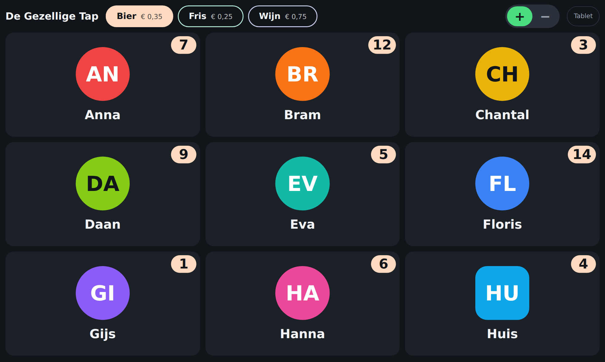
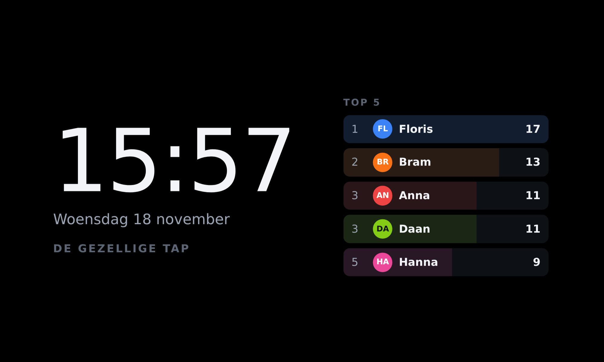
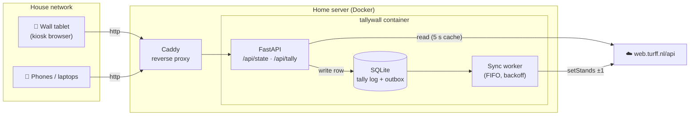

<div align="center">

# 🍺 tallywall

**A big-button touch screen for the house drinks tally, with [Turff](https://turff.nl) as the backend of record.**

Tap a housemate's face, and that's one more drink on their tab. Works on the wall-mounted tablet and on any phone or laptop on the house Wi-Fi.



</div>

> [!IMPORTANT]
> **Unofficial project, not affiliated with Turff.** tallywall is not made, endorsed or supported by Turff.
> It talks to Turff's undocumented web API, which can change or break at any time. See the [Disclaimer](#disclaimer).

---

## Contents

- [Features](#features)
- [How it works](#how-it-works)
- [Requirements](#requirements)
- [Deploy](#deploy)
- [Operations](#operations)
- [Configuration](#configuration)
- [Kiosk tablet setup](#kiosk-tablet-setup)
- [Development](#development)
- [HTTP API](#http-api)
- [Troubleshooting](#troubleshooting)
- [Disclaimer](#disclaimer)

## Features

- **One tap, one drink.** Big tiles with photos (or initials on the person's Turff colour) and a live count badge.
- **Drink selector** with prices (`€ 0,35`). Each device remembers its own last choice.
- **+/− switch**, like on Turff's own tablets, for correcting mistakes. It flips back to + after 10 seconds.
- **Survives outages.** Taps go into a local outbox and sync to Turff in order once it's reachable again.
  The UI keeps working from cached data in the meantime.
- **Stays in sync** with changes made in the Turff app: new drinks, prices, people, names and colours show up
  within seconds.
- **Screensaver** after 60 s idle: a clock, the date in Dutch and a top-5 leaderboard, dimmed at night
  (23:00–07:00).
- **Private by design.** The browser never talks to Turff and never sees credentials, email addresses or
  phone numbers.

<p align="center"></p>

## How it works



**When someone taps a tile:**

1. The page immediately shows +1 (optimistic) and sends `POST /api/tally`.
2. The backend stores the tally in its local SQLite table. Together, these rows form the **outbox**.
3. The single sync worker sends outbox rows to Turff (`setStands`) one at a time, in order. If Turff is
   down, it retries with backoff (2 s to 60 s). Nothing is lost on a restart.
4. The response says whether the tally already synced. Either way, the count stays correct, because the
   counts shown are Turff's numbers plus any tallies still in the outbox.

**Reads** (`GET /api/state`) combine house info, drinks and per-drink counts from Turff, cached for 5 seconds.
When Turff is unreachable, the last known state is served with `stale: true`.

> [!NOTE]
> tallywall uses Turff's **unofficial** web API, reverse-engineered from web.turff.nl. It can change without
> notice. All Turff calls live in [`src/tallywall/turff/client.py`](src/tallywall/turff/client.py).

**Stack:** Python 3.12 · FastAPI · httpx · SQLite · vanilla HTML/CSS/JS (no build step) · Docker.

## Requirements

- A Linux server with **Docker** and the **compose plugin**.
- A **Caddy** container on a Docker network that other stacks can join (this guide assumes it's called `caddy`).
- A dedicated **Turff account** for tallywall that is **beheerder** (manager) of the house.
  Ordinary residents can read but not add tallies (`ERR_HOUSE_USER_IS_NOT_MANAGER`).
  This account shows up as a person in the house, and tallywall hides its tile automatically.
- The **house UID** of the Turff house.

## Deploy

### 1. Get the code

```sh
git clone https://github.com/lorivaro/tallywall.git
cd tallywall
mkdir -p data avatars
```

`data/` holds the SQLite database. `avatars/` holds optional photos. Both are gitignored.

### 2. Configure

```sh
cp .env.example .env
chmod 600 .env
$EDITOR .env
```

Fill in `TURFF_EMAIL`, `TURFF_PASSWORD` and `TURFF_HOUSE_UID`. Then point `TRUSTED_PROXIES` at the Caddy
network, so the client IPs in the tally log are the real ones and not Caddy's:

```sh
docker network inspect caddy -f '{{(index .IPAM.Config 0).Subnet}}'
# 172.18.0.0/16  → TRUSTED_PROXIES=172.18.0.0/16
```

If your Caddy network has a different name, also set `CADDY_NETWORK`. The container runs as `1000:1000` by
default. If `data/` is owned by another user, set `UID`/`GID` in `.env` to match.

### 3. Add a Caddy site

The tablet uses plain http on the LAN, so the site address starts with `http://` and Caddy won't try to get a
certificate:

```caddyfile
http://tally.lan, http://192.168.1.10 {
	reverse_proxy tallywall:8000
}
```

Point `tally.lan` at the server in your router or Pi-hole local DNS, or just use the IP address. Reload Caddy:

```sh
docker exec caddy caddy reload --config /etc/caddy/Caddyfile
```

### 4. Start

```sh
docker compose up -d --build
docker compose ps          # STATUS should become "healthy"
docker compose logs -f     # look for "tallywall started: mode=real, 0 tallies in outbox"
```

Open `http://tally.lan`. The first visit on each device asks for a device name.

## Operations

| Task | Command |
|---|---|
| Update | `git pull && docker compose up -d --build` |
| Logs | `docker compose logs -f tallywall` |
| Restart | `docker compose restart` (the outbox survives) |
| Health | `docker exec tallywall python -c "import urllib.request as u; print(u.urlopen('http://127.0.0.1:8000/api/health').read())"` |
| Outbox size | `GET /api/health` → `{"ok": true, "pending": 0}` |

**Backups.** The only state is `data/tallywall.db`. Turff remains the source of truth for the counts, and the
local database adds which device and IP made each tally. For a consistent copy while the app runs:

```sh
sqlite3 data/tallywall.db ".backup data/tallywall-$(date +%F).db"
```

**Photos.** Put a square JPEG named after the person's Turff UID in `avatars/` (`avatars/<personUid>.jpg`).
No restart is needed: new photos appear after a page reload, and a replaced photo may take up to an hour (browser cache). To find UIDs, look at the `people[].id`
values in `/api/state`.

## Configuration

All settings are environment variables, read from `.env` by compose.

| Variable | Default | Meaning |
|---|---|---|
| `TURFF_MODE` | `real` | `real` talks to Turff. `fake` runs an in-memory demo house (no credentials needed). |
| `TURFF_EMAIL` | — | Service account login (required in `real` mode). |
| `TURFF_PASSWORD` | — | Service account password (required in `real` mode). |
| `TURFF_HOUSE_UID` | — | Target house (required in `real` mode). |
| `TRUSTED_PROXIES` | `127.0.0.1,::1` | IPs/CIDRs whose `X-Forwarded-For` header is trusted. Set it to the Caddy network subnet. |
| `CADDY_NETWORK` | `caddy` | External Docker network shared with Caddy (compose only). |
| `UID` / `GID` | `1000` | User the container runs as. Must be able to write `data/` (compose only). |
| `DB_PATH` | `/data/tallywall.db` | SQLite file (inside the container). |
| `AVATARS_DIR` | `/avatars` | Photo directory (inside the container). |
| `TURFF_BASE_URL` | `https://web.turff.nl/api` | Turff API base URL. |
| `HOST` / `PORT` | `0.0.0.0` / `8000` | Listen address. |
| `TURFF_FAKE_OUTAGE` | off | `fake` mode only: start with Turff "unreachable". |

## Kiosk tablet setup

> [!IMPORTANT]
> This is a sketch and **hasn't been verified on the device yet**. The target is a Samsung Galaxy Tab A7
> (Android 12, 2000×1200), wall-mounted in landscape and always on the charger.

**Option A: Fully Kiosk Browser** (recommended; the free version covers the basics)

1. Install *Fully Kiosk Browser* from the Play Store.
2. **Start URL:** `http://tally.lan`.
3. **Web content settings:** disable pull-to-refresh and zoom.
4. **Device management:** *Keep screen on* ✔, *Launch on boot* ✔, *Unlock screen* ✔.
5. **Fullscreen mode:** hide the status bar and navigation bar.
6. **Kiosk mode** (PLUS licence): lock the tablet to the app and protect the settings with a PIN.
7. Optionally use *Screen off timer* / *Scheduled sleep* to turn the backlight off at night. tallywall's own
   night mode only dims the page content.

**Option B: Chrome + screen pinning** (no extra app)

1. Open `http://tally.lan` in Chrome, then use ⋮ → *Add to home screen*.
2. Settings → Security → *Pin app* on, then pin the app from the recent apps view.
3. Developer options → *Stay awake* (the screen stays on while charging).

**Either way:**

- Samsung Settings → Battery → *Protect battery* (charging limit of 85 %). This matters a lot for a tablet that
  is always charging.
- Turn off the lock screen (Settings → Lock screen → *None*), so it recovers on its own after a power cut.
- On first launch, give the device a clear name, e.g. `Tablet hal`. The name is stored with every tally it makes.
- Exclude the browser from battery optimisation, so Android doesn't kill it.

## Development

```sh
uv sync                                  # Python 3.12 + deps into .venv
TURFF_MODE=fake uv run tallywall         # http://localhost:8000 with a demo house
uv run pytest                            # tests; Turff is mocked with respx, never hit
uv run ruff check && uv run ruff format --check
```

In `fake` mode, two extra endpoints simulate the outside world:

```sh
# Turff goes down / comes back
curl -X POST localhost:8000/api/dev/outage -H 'content-type: application/json' -d '{"on": true}'
# someone changes things in the Turff app
curl -X POST localhost:8000/api/dev/fake -H 'content-type: application/json' \
     -d '{"op": "drink", "id": "fake-cola", "name": "Cola", "price": 300}'
```

`op` is one of `drink`, `remove_drink`, `person`, `remove_person`, `tally`, `house`.

**Rules:** during development, real writes only go to a dedicated test house. The production house is only
touched by the deployed instance. Secrets go in `.env` only, which is never committed.

Project layout:

```
src/tallywall/
├── app.py          FastAPI routes, client IP handling, static frontend
├── state.py        /api/state builder + 5 s cache
├── db.py           SQLite tally log / outbox
├── outbox.py       sync worker (the only caller of setStands)
├── config.py       env → Settings
├── turff/          Turff client, error types, in-memory fake
└── static/         index.html, app.js, app.css
```

## HTTP API

| Method & path | Purpose |
|---|---|
| `GET /api/state` | Drinks, people with counts per drink, house name, `stale`, `pending`. 503 if Turff is down and nothing is cached. |
| `POST /api/tally` | `{person, drink, amount?: 1 \| -1, device_id?, device_name?}` → `201 {id, synced}` |
| `POST /api/tally/{id}/undo` | Undoes a +1 from the last 10 minutes → `{id, synced, cancelled}` |
| `GET /api/health` | Liveness, never calls Turff → `{ok, pending}` |
| `GET /avatars/{uid}.jpg` | Local photo, 404 if missing |

## Troubleshooting

| Symptom | Likely cause |
|---|---|
| Container keeps restarting, log says `missing required settings` | `.env` incomplete. Check `TURFF_EMAIL` / `TURFF_PASSWORD` / `TURFF_HOUSE_UID`. |
| `unable to open database file` / permission denied | `data/` isn't writable by the container user. `chown 1000:1000 data` or set `UID`/`GID`. |
| `network caddy declared as external, but could not be found` | Wrong network name. Set `CADDY_NETWORK`. |
| Full-screen "Can't reach Turff — retrying…" | Turff is unreachable and the app has no cache yet. Check `docker compose logs` for the Turff error. |
| Header says "No connection" | The browser can't reach the server: check Caddy, DNS and the container. |
| Header says "Turff offline" | Turff is down. Counts come from the cache, and taps queue up and sync later. |
| Tallies don't reach Turff, log shows `rejected by Turff … ERR_HOUSE_USER_IS_NOT_MANAGER` | The service account isn't beheerder of the house. Rejected tallies are dropped from the outbox (kept in SQLite with `failed_at`). |
| The tally log shows Caddy's IP for every tap | `TRUSTED_PROXIES` doesn't include the Caddy network subnet. |
| An old version still shows after an update | Reload the page. Static files are revalidated on every load, so one reload is enough. |

## Disclaimer

**tallywall is an independent, unofficial project. It is not affiliated with, endorsed by, or supported by Turff.**
"Turff" is the name of its owner's product and is used here only to say what tallywall works with.
Please don't contact Turff support about tallywall.

- It uses Turff's **undocumented** web API, the same one web.turff.nl uses. Turff offers no public API, and this
  one can change or break at any time.
- You need your **own** Turff account with beheerder rights on **your own** house. Use tallywall only for houses
  you manage, and follow [Turff's terms](https://www.turff.nl/algemene-voorwaarden/).
- **Be gentle with Turff's servers.** tallywall caches reads for 5 seconds, shares one cache between all screens,
  and sends one write per tap. Don't shorten the intervals or point it at many houses.
  Requests carry a `tallywall` User-Agent, so Turff can tell where the traffic comes from.
- If Turff asks for this project to change or be taken down, it will be.
- Provided as is, without warranty (see [LICENSE](LICENSE)). Turff stays the record: check the tallies there
  before settling up.

---

<sub>MIT licensed. Unofficial, not affiliated with Turff.</sub>
